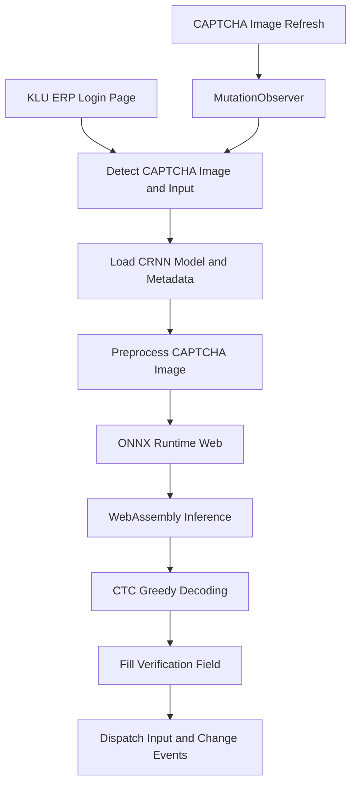

<!--
  KLU ERP Auto-Fill
  Documentation for the Chrome Manifest V3 extension.
-->

<div align="center">

# KLU ERP Auto-Fill

**A local-first Chrome extension for the KL University ERP login page.**

Recognizes the CAPTCHA image with a bundled CRNN model and fills the verification field using ONNX Runtime Web and WebAssembly.

[](https://developer.chrome.com/docs/extensions/)
[](https://developer.chrome.com/docs/extensions/develop/migrate/what-is-mv3)
[](https://developer.mozilla.org/en-US/docs/Web/JavaScript)
[](https://onnxruntime.ai/docs/tutorials/web/)

[**View Repository**](https://github.com/tejaswin-amara/klu-erp-autofill) · [**Open KLU ERP**](https://newerp.kluniversity.in/)

</div>

---

## Overview

KLU ERP Auto-Fill is a Chrome extension designed to reduce repetitive manual CAPTCHA entry on the KL University ERP login page.

It uses a bundled **Convolutional Recurrent Neural Network (CRNN)** in ONNX format. The extension processes the CAPTCHA image in the browser, decodes the model output into a character sequence, and places the recognized text in the verification field.

The inference pipeline uses **ONNX Runtime Web** and **WebAssembly (WASM)** rather than a separate cloud OCR service.

> **Important:** This extension fills the verification field only. It does not submit the login form, authenticate an account, or guarantee correct CAPTCHA recognition. Verify the result before continuing.

## Features

| Feature | Description |
| --- | --- |
| CAPTCHA recognition | Runs the bundled CRNN model against the detected CAPTCHA image. |
| Automatic field filling | Places the recognized sequence in the verification input. |
| Local inference | Uses ONNX Runtime Web and bundled WebAssembly assets. |
| Refresh detection | Observes CAPTCHA image source changes and attempts recognition again. |
| Manifest V3 | Uses Chrome's current extension manifest format. |
| Focused website scope | Content-script injection is configured for the KLU ERP hostname. |
| Input events | Dispatches `input` and `change` events after updating the field. |

## How It Works



### Processing pipeline

1. **Detect page elements:** The content script looks for the CAPTCHA image and its corresponding verification input.
2. **Initialize inference:** It loads the model metadata and initializes an ONNX Runtime inference session.
3. **Preprocess the image:** The CAPTCHA image is drawn to a canvas and converted into the tensor format expected by the model.
4. **Run inference:** The CRNN model processes the tensor through the WebAssembly execution provider.
5. **Decode the output:** Greedy CTC-style decoding converts the model output into a character sequence.
6. **Fill the field:** The recognized text is assigned to the verification input, followed by native `input` and `change` events.
7. **Handle refreshes:** A `MutationObserver` watches the CAPTCHA image's `src` attribute and can trigger another recognition attempt.

The implementation also limits its initial element-search attempts so it does not retry indefinitely when expected page elements are absent.

## Technology Stack

| Component | Technology | Role |
| --- | --- | --- |
| Extension platform | Chrome Manifest V3 | Defines extension metadata, scripts, and resources |
| Core logic | JavaScript | Page detection and inference orchestration |
| Recognition model | CRNN / ONNX | Predicts CAPTCHA character sequences |
| Inference runtime | ONNX Runtime Web | Executes the model in the browser |
| Compute backend | WebAssembly | Runs inference locally |
| Output decoding | CTC greedy decoding | Converts model output into text |
| Page observation | `MutationObserver` | Detects CAPTCHA image-source changes |

## Project Structure

```text
klu-erp-autofill/
├── manifest.json
├── content.js
├── model/
│   ├── crnn.onnx
│   └── crnn.json
├── lib/
│   ├── ort.min.js
│   ├── ort-wasm-simd.wasm
│   └── ort-wasm.wasm
└── icons/
    ├── icon16.png
    ├── icon48.png
    └── icon128.png
```

| Path | Purpose |
| --- | --- |
| `manifest.json` | Extension metadata, content-script configuration, and resource declarations |
| `content.js` | CAPTCHA detection, preprocessing, inference, decoding, and field filling |
| `model/crnn.onnx` | Bundled CRNN recognition model |
| `model/crnn.json` | Model metadata, including input dimensions and recognition alphabet |
| `lib/ort.min.js` | ONNX Runtime Web JavaScript runtime |
| `lib/ort-wasm-simd.wasm` | SIMD-enabled WebAssembly runtime |
| `lib/ort-wasm.wasm` | Standard WebAssembly runtime |
| `icons/` | Extension icons in supported sizes |

## Installation

The extension can be loaded locally in Chrome using Developer mode.

### 1. Get the repository

Clone the repository:

```bash
git clone https://github.com/tejaswin-amara/klu-erp-autofill.git
cd klu-erp-autofill
```

Alternatively, use **Code → Download ZIP** on GitHub and extract the archive.

### 2. Open Chrome Extensions

Navigate to:

```text
chrome://extensions
```

Enable **Developer mode**.

### 3. Load the extension

1. Click **Load unpacked**.
2. Select the project directory containing `manifest.json`.
3. Confirm that Chrome lists the extension without an error.

Keep the project directory intact: the model, runtime, WebAssembly files, and icons are loaded from paths inside it.

### 4. Test on KLU ERP

1. Open the [KLU ERP login page](https://newerp.kluniversity.in/).
2. Ensure the extension is enabled.
3. Reload the ERP tab.
4. Check whether the verification field is populated.
5. Verify the recognized text before submitting the form.

Use the university login system only in accordance with applicable institutional rules and authorization requirements.

## Configuration and Compatibility

| Setting | Current implementation |
| --- | --- |
| Target URL | `https://newerp.kluniversity.in/*` |
| Extension format | Chrome Manifest V3 |
| Model | `model/crnn.onnx` |
| Metadata | `model/crnn.json` |
| Model input dimensions | `120 × 50`, as specified in metadata |
| Inference runtime | ONNX Runtime Web |
| Execution backend | WebAssembly |
| Refresh detection | Watches the CAPTCHA image's `src` attribute |

The model metadata defines the recognition alphabet and CTC blank index. Changes to the ERP page structure, CAPTCHA appearance, model format, or preprocessing requirements may require corresponding code or model updates.

## Privacy and Security

The recognition pipeline uses the model and runtime files bundled with the extension. It does not require a separate remote OCR backend. This does **not** mean the ERP website itself operates offline: normal website requests still go to the website's servers.

Keep the following points in mind:

- **Console output:** The current content script logs debug information, including recognized CAPTCHA text. Do not share unredacted browser-console logs or screenshots containing verification codes.
- **Credentials:** The extension is intended to fill the verification field, not to collect or manage account credentials. Review the source before installing or distributing modified versions.
- **Permissions and scope:** Review `manifest.json` before changing the domains on which the content script can execute.
- **Recognition limitations:** Results can be incorrect. Check the field before submitting the login form.
- **Responsible use:** CAPTCHA challenges are anti-automation controls. Use this extension only where permitted by the institution and applicable website policies.

For a production release, review diagnostic logging and remove sensitive recognition output where it is not needed.

## Troubleshooting

<details>
<summary><strong>The verification field is not populated</strong></summary>

- Confirm that the current page is [KLU ERP](https://newerp.kluniversity.in/).
- Confirm that the extension is enabled.
- Reload the extension from `chrome://extensions`, then reload the ERP tab.
- Check that the model and runtime files are present in their expected directories.
- Inspect Chrome DevTools Console for messages prefixed with `[KLU-Captcha]`.
- Check whether the page's current CAPTCHA image and input elements match the selectors in `content.js`.

</details>

<details>
<summary><strong>The model or WebAssembly runtime fails to load</strong></summary>

- Verify that `model/crnn.onnx` and `model/crnn.json` exist.
- Verify that the files in `lib/` have not been renamed or removed.
- Check the resource paths declared in `manifest.json`.
- Use an up-to-date Chrome or Chromium-based browser and inspect the exact console error.

</details>

<details>
<summary><strong>The field contains incorrect text</strong></summary>

Recognition is not guaranteed. Accuracy depends on the CAPTCHA image, model capabilities, and compatibility between the page image and model preprocessing.

Verify the result before submitting. If recognition fails, use the site's normal verification process.

</details>

<details>
<summary><strong>Source changes are not appearing</strong></summary>

1. Save the modified files.
2. Open `chrome://extensions`.
3. Click **Reload** on the extension.
4. Reload the ERP tab.

</details>

## Development

To work on the extension locally:

1. Clone the repository.
2. Review `manifest.json` for extension configuration and URL scope.
3. Review `content.js` for element detection, preprocessing, inference, decoding, and input updates.
4. Keep model metadata aligned with the model's expected input and output.
5. Reload the extension and ERP tab after code changes.
6. Test model loading, missing page elements, recognition failures, and CAPTCHA refresh behavior.

This repository is a browser extension rather than a conventional Node.js application. Do not assume a package manager or build command is required unless one is added to the project.

## Contributing

Contributions that improve reliability, maintainability, accessibility, and transparency are welcome.

Useful areas for improvement include:

- More resilient detection of page elements.
- Clearer error handling and diagnostics.
- Removal of sensitive information from debug output.
- Compatibility checks for model inputs and outputs.
- Reproducible tests and improved documentation.

Keep changes focused, test them against the intended environment, and document any new dependencies or permissions.

## Author

**Tejaswin Amara**

- GitHub: [@tejaswin-amara](https://github.com/tejaswin-amara)
- Repository: [klu-erp-autofill](https://github.com/tejaswin-amara/klu-erp-autofill)

## License

No `LICENSE` file was present when this README was prepared. Unless a license is added, do not assume the source code or bundled model may be redistributed under an open-source license.

---

<div align="center">

Built with JavaScript, ONNX Runtime Web, and WebAssembly.

[Back to top](#klu-erp-auto-fill)

</div>
