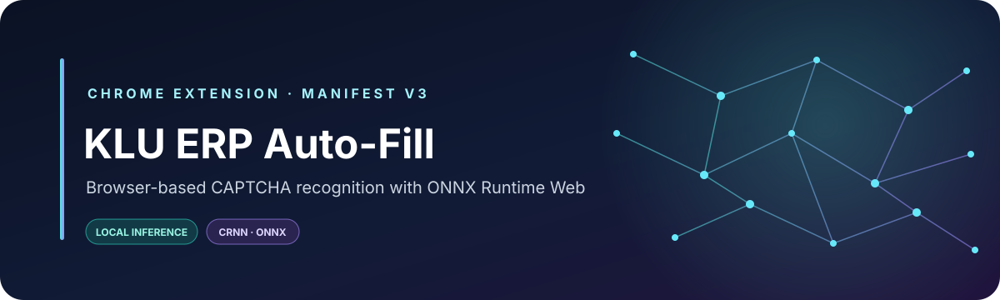
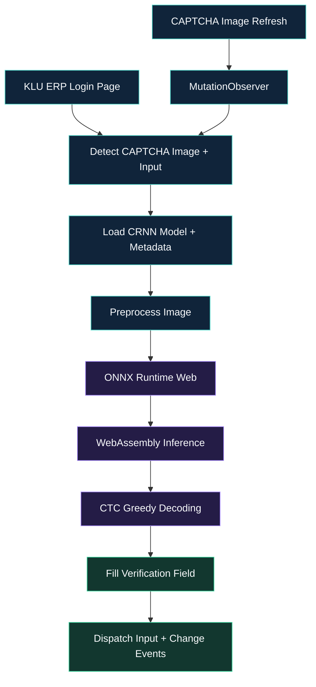

<!-- KLU ERP Auto-Fill | Project documentation -->

<div align="center">
  

  <p><strong>A focused Chrome extension for the KL University ERP login page.</strong></p>
  <p>Recognize CAPTCHA text in-browser with a bundled CRNN model, ONNX Runtime Web, and WebAssembly.</p>

  <p>
    <a href="https://newerp.kluniversity.in/"><strong>Open KLU ERP</strong></a>
    &nbsp; · &nbsp;
    <a href="#installation"><strong>Installation</strong></a>
    &nbsp; · &nbsp;
    <a href="#how-it-works"><strong>How it works</strong></a>
  </p>

  <p>
    <a href="https://developer.chrome.com/docs/extensions/"></a>
    <a href="https://developer.chrome.com/docs/extensions/develop/migrate/what-is-mv3"></a>
    <a href="https://onnxruntime.ai/docs/tutorials/web/"></a>
    
    
  </p>
</div>

---

## At a glance

<table>
  <tr>
    <td width="50%">
      <strong>⚡ Browser-based inference</strong><br>
      The bundled ONNX model runs through ONNX Runtime Web and WebAssembly.
    </td>
    <td width="50%">
      <strong>🔄 Refresh-aware</strong><br>
      Watches for CAPTCHA image source changes and attempts recognition again.
    </td>
  </tr>
  <tr>
    <td width="50%">
      <strong>🎯 Narrow website scope</strong><br>
      The content script is configured for the KLU ERP hostname.
    </td>
    <td width="50%">
      <strong>🧩 Minimal setup</strong><br>
      Load the project directory directly in Chrome; no build step is currently required.
    </td>
  </tr>
</table>

> **Important:** This extension fills the verification field only. It does not submit the login form, authenticate an account, or guarantee correct recognition. Verify the result before continuing, and use automation only when permitted by university and website policies.

## Contents

- [How it works](#how-it-works)
- [Technology stack](#technology-stack)
- [Project structure](#project-structure)
- [Installation](#installation)
- [Configuration and compatibility](#configuration-and-compatibility)
- [Privacy and security](#privacy-and-security)
- [Troubleshooting](#troubleshooting)
- [Development](#development)
- [Contributing](#contributing)
- [License](#license)
- [Privacy notes](docs/PRIVACY.md)
- [Security policy](SECURITY.md)
- [Support](SUPPORT.md)
- [Third-party notices](THIRD_PARTY_NOTICES.md)
- [Changelog](CHANGELOG.md)

## How it works



### Recognition pipeline

1. **Detect:** Find the CAPTCHA image and verification input on the configured ERP page.
2. **Initialize:** Load the bundled ONNX model metadata and create an inference session.
3. **Preprocess:** Draw the CAPTCHA image to a canvas and prepare the tensor expected by the model.
4. **Infer:** Run the CRNN model through ONNX Runtime Web using WebAssembly.
5. **Decode:** Convert model output into a character sequence using greedy CTC-style decoding.
6. **Fill:** Update the verification field and dispatch `input` and `change` events.
7. **Observe:** Watch for changes to the CAPTCHA image's `src` attribute and retry recognition when appropriate.

## Technology stack

| Layer | Technology | Purpose |
| --- | --- | --- |
| Extension platform | Chrome Manifest V3 | Declares scripts, permissions, and web-accessible resources |
| Application logic | JavaScript | DOM detection and inference orchestration |
| Recognition model | CRNN in ONNX format | Predicts the CAPTCHA character sequence |
| Inference runtime | ONNX Runtime Web | Loads and executes the model |
| Compute backend | WebAssembly (WASM) | Runs inference in the browser |
| Sequence decoding | Greedy CTC-style decoding | Converts model output into text |
| DOM observation | `MutationObserver` | Detects CAPTCHA image source changes |

## Project structure

```text
klu-erp-autofill/
├── manifest.json
├── content.js
├── assets/
│   └── readme-banner.svg
├── model/
│   ├── crnn.onnx
│   └── crnn.json
├── lib/
│   ├── ort.min.js
│   ├── ort-wasm-simd.wasm
│   └── ort-wasm.wasm
└── icons/
    ├── icon16.png
    ├── icon48.png
    └── icon128.png
```

| File or directory | Description |
| --- | --- |
| `manifest.json` | Extension metadata, content-script configuration, and resource declarations |
| `content.js` | CAPTCHA detection, preprocessing, inference, decoding, and field filling |
| `model/crnn.onnx` | Bundled CRNN recognition model |
| `model/crnn.json` | Model metadata, including input dimensions and recognition alphabet |
| `lib/ort.min.js` | ONNX Runtime Web JavaScript runtime |
| `lib/*.wasm` | WebAssembly runtime assets |
| `icons/` | Chrome extension icons |
| `assets/readme-banner.svg` | Custom repository README banner |

## Installation

### 1. Download the project

Clone the repository:

```bash
git clone https://github.com/tejaswin-amara/klu-erp-autofill.git
cd klu-erp-autofill
```

Or select **Code → Download ZIP** on GitHub and extract the archive.

### 2. Open Chrome's extension manager

Visit:

```text
chrome://extensions
```

Enable **Developer mode**.

### 3. Load the extension

1. Select **Load unpacked**.
2. Choose the project folder containing `manifest.json`.
3. Confirm that Chrome displays the extension without an error.

**Keep the folder intact.** The model, runtime, WebAssembly assets, icons, and banner use paths within the project.

### 4. Test on the ERP page

1. Open [KLU ERP](https://newerp.kluniversity.in/).
2. Ensure the extension is enabled.
3. Reload the ERP tab.
4. Check whether the verification field is populated.
5. Review the recognized text before submitting the form.

## Configuration and compatibility

| Setting | Current implementation |
| --- | --- |
| Target URL | `https://newerp.kluniversity.in/*` |
| Extension format | Chrome Manifest V3 |
| Model file | `model/crnn.onnx` |
| Model metadata | `model/crnn.json` |
| Input dimensions | `120 × 50`, as specified in metadata |
| Inference runtime | ONNX Runtime Web |
| Execution backend | WebAssembly |
| Refresh handling | Observes the CAPTCHA image's `src` attribute |

The metadata defines the model's recognition alphabet and CTC blank index. Changes to the ERP page structure, CAPTCHA design, or model preprocessing may require code or model updates.

## Privacy and security

The recognition pipeline uses the model and runtime bundled with the extension and does not require a separate remote OCR backend. This does **not** mean the ERP website itself operates offline: normal website communication still occurs.

- **Console logging:** The current content script logs diagnostic messages, including recognized CAPTCHA text. Do not share unredacted console logs or screenshots containing verification codes.
- **Credentials:** The extension is intended to fill the verification field, not to collect or manage account credentials. Review the source before installing or distributing a modified build.
- **Scope:** Review `manifest.json` before changing the domain on which the content script can run.
- **Accuracy:** Recognition can be incorrect. Check the result before submitting.
- **Responsible use:** CAPTCHA is an anti-automation control. Use this project only where authorized by the institution and the website's applicable policies.

For more detail, see the [privacy notes](docs/PRIVACY.md) and [security policy](SECURITY.md). For a production release, review diagnostic output and remove sensitive recognition text from logs when it is not required.

## Troubleshooting

<details>
<summary><strong>The verification field is not populated</strong></summary>

- Confirm that you are on [KLU ERP](https://newerp.kluniversity.in/).
- Ensure the extension is enabled.
- Reload the extension at `chrome://extensions`, then reload the ERP tab.
- Check that the model and runtime assets exist at the expected paths.
- Inspect Chrome DevTools Console for messages prefixed with `[KLU-Captcha]`.
- Confirm that the page's current image and input elements match the selectors in `content.js`.

</details>

<details>
<summary><strong>The model or WASM runtime fails to load</strong></summary>

- Verify that `model/crnn.onnx` and `model/crnn.json` exist.
- Check that the files under `lib/` have not been renamed or removed.
- Confirm that the paths in `manifest.json` match the files on disk.
- Use an up-to-date Chrome or Chromium-based browser and inspect the exact console error.

</details>

<details>
<summary><strong>The recognized text is incorrect</strong></summary>

Recognition accuracy is not guaranteed. It depends on the CAPTCHA image, the model, and compatibility between the page image and model preprocessing. Verify the text before submitting; if recognition fails, use the site's normal verification process.

</details>

<details>
<summary><strong>Changes to the source are not appearing</strong></summary>

1. Save your edits.
2. Open `chrome://extensions`.
3. Click **Reload** on the extension.
4. Reload the ERP tab.

</details>

## Development

1. Clone the repository.
2. Inspect `manifest.json` for extension configuration and target URL scope.
3. Review `content.js` for element detection, preprocessing, inference, decoding, and field updates.
4. Keep the model metadata aligned with the model's expected input and output.
5. Reload the extension and ERP tab after changes.
6. Test model loading, missing page elements, recognition failures, and CAPTCHA refresh handling.

This is a browser extension rather than a conventional Node.js application. No package manager or build command is assumed by the current project structure.

## Contributing

Contributions that improve reliability, maintainability, and transparency are welcome. Read the [contribution guidelines](CONTRIBUTING.md) before opening a pull request. Community participation is governed by the [Code of Conduct](CODE_OF_CONDUCT.md); use the [issue templates](.github/ISSUE_TEMPLATE/) for bug reports and feature requests.

Potential areas for improvement:

- More robust detection of page elements.
- Clearer error handling and diagnostics.
- Removal of sensitive information from debug output.
- Compatibility checks for model inputs and outputs.
- Reproducible tests and clearer setup instructions.

Keep changes focused, test them against the intended environment, and document new dependencies or permissions.

## Author

**Tejaswin Amara**

- GitHub: [@tejaswin-amara](https://github.com/tejaswin-amara)
- Repository: [klu-erp-autofill](https://github.com/tejaswin-amara/klu-erp-autofill)

## License

The repository's [LICENSE](LICENSE) file currently states that **no project open-source license has been granted**. Do not assume that public availability on GitHub grants permission to use, modify, or redistribute the source code. Bundled third-party libraries and model assets may have separate terms; see [THIRD_PARTY_NOTICES.md](THIRD_PARTY_NOTICES.md).

---

<div align="center">
  <sub>Built with JavaScript, ONNX Runtime Web, and WebAssembly.</sub><br>
  <sub><a href="#klu-erp-auto-fill">Back to top ↑</a></sub>
</div>
